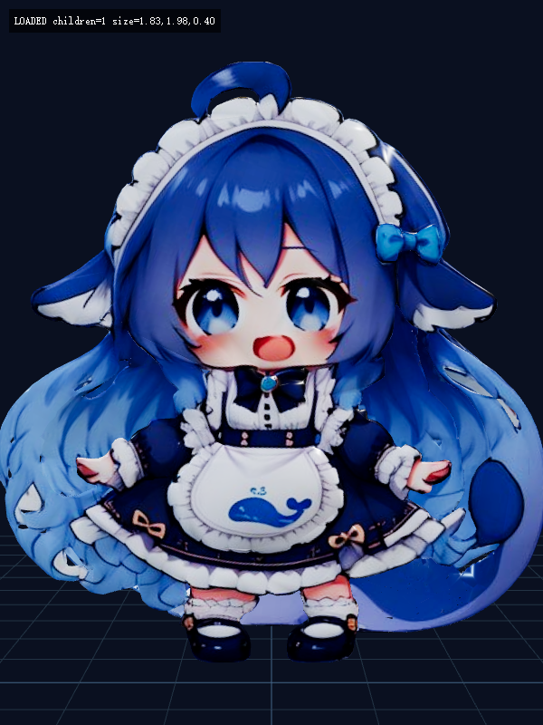
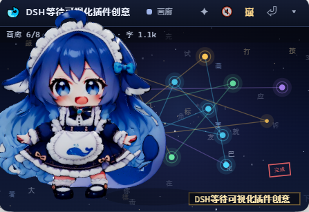

# Tide Atelier · 潮汐工坊

> **把 DSH 的每一次工具调用，画成一片会生长的潮汐星图。**
>
> Turn DeepSeek Harness activity into a living constellation, garden or city — with a 3D whale-maid companion.



> Local render of the generated GLB model.



> Real DSH UI screenshot: constellation form. The pet scale in this capture predates the final compact sizing.

**Status:** `0.1.0` release candidate, verified against the DSH client-module contract (`npm run verify`). npm publication is pending the owner's npm login; the GitHub tag `v0.1.0` is the install source and was re-pointed to the fixed commit (see [`CHANGELOG.md`](CHANGELOG.md)).

**Repository:** https://github.com/JIQ1314an/dsh-tide-atelier

## 这不是又一个桌宠

拖拽、悬浮、点击互动、状态气泡已经是桌宠的基本功，社区里也有很多做得很好的项目。Tide Atelier 不再重复喂食、换装、随机走动、额外聊天系统。

它真正不同的地方是：**把 Agent 正在做的工作，变成一幅会生长的画。**

- 每一次 tool call 变成一颗星 / 一株植物 / 一栋楼。
- 子代理变成卫星 / 蝴蝶 / 无人机。
- 错误变成红色裂隙 / 杂草 / 裂缝与火光。
- 流式输出的字符变成星尘 / 草叶与花瓣 / 亮起的窗户。
- 同一个任务可以在 **星图、花园、城市** 三种视觉语言之间切换。
- 完成的任务进入画廊；画廊保存的是任务描述符，不是截图，所以旧任务也能用另一种形态重新观看。
- 三种形态各有自己的 chiptune 音轨，音效层随工具活动增强。

桌宠是入口，作品才是记忆点。

## 安装

一条命令（推荐，锁定 GitHub tag）：

```bash
dsh plugin --profile web add https://github.com/JIQ1314an/dsh-tide-atelier.git#v0.1.0
```

装完刷新一次 Web UI 即可看到宠物。这个包**没有 `prepare`/安装期构建脚本**，产物直接进仓库，所以一条命令安装不需要批准任何 build script；也不要为了"规范化"给它加上 `prepare`——那会让所有用户在 `pnpm` 首次运行时被脚本批准流程卡住。

发布到 npm 后：

```bash
dsh plugin --profile web add dsh-tide-atelier
```

本地开发版：

```bash
dsh plugin --profile web add D:\Project\dsh-tide-atelier
```

> 如果本机还装着旧的 `@local/dsh-activity-quest` 版本，请先禁用/卸载它，避免两个宠物同时注册。

### 已经装过旧 v0.1.0 的人（2026-11-14 之前）

git 依赖被 profile 锁死在**具体 commit**，移动 tag 不会自动生效，需要重跑一次安装命令：

```bash
dsh plugin --profile web remove dsh-tide-atelier
dsh plugin --profile web add https://github.com/JIQ1314an/dsh-tide-atelier.git#v0.1.0
```

如果只是在 `node_modules` 里手改了 `client.js`，则必须**完整重启该 profile**（`dsh web`）：客户端 bundle 的字节在激活时读入并缓存，热重载只覆盖 profile 自己的 patch 层。

## 你会看到

| Agent 活动 | 星图 | 花园 | 城市 |
|---|---|---|---|
| tool call | 星星 | 植物 | 建筑 |
| tool 完成 | 光环 | 开花 | 亮灯 |
| 子代理运行 | 卫星 | 蝴蝶 | 无人机 |
| 错误 | 红色裂隙 | 杂草 | 裂缝/火光 |
| 流式字符 | 星尘 | 草叶/花瓣 | 窗户亮起 |

- 顶栏切换 **✦ 星图 / ✿ 花园 / ▥ 城市**。
- `🖼` 浏览当前会话最近的任务；`⏎` 回到实时画面。
- 每次任务结束出现完成印章；画廊最多保留 8 条。
- 音轨随形态切换；浏览器要求首次点击后才开始播放。

## 3D 宠物

- 模型由项目所有者提供的 **Q 版大肥鱼三视图** 经 **Tencent Hunyuan3D 2.1** 生成，压缩后嵌入 `client.js`。
- 当前是 **正面朝向的 GLB**：有贴图、有根节点浮动/呼吸、点击弹跳、拖拽倾斜和状态反应。
- **没有骨骼**，所以没有眨眼、走路、手臂独立动作；**背面是单图生成的弱项**，因此不提供 360° 转圈，宠物保持正面。
- 模型完全在浏览器端渲染（Three.js / WebGL），不从网络加载模型。

## 隐私

- **纯客户端插件**：不注册 Host 进程，不新增模型可见工具，不发起网络请求。
- 只通过 DSH 注入的 `useChat` / `useSessions` / `useSessionStatus` 读取当前会话的渲染状态。
- 不读取文件内容，不把会话内容发送到任何服务器。
- 下列状态只写入浏览器 `localStorage`：
  - `dsh-activity-quest:pet-open`
  - `dsh-activity-quest:pet-position`
  - `dsh-activity-quest:form`
  - `dsh-activity-quest:sound`
  - `dsh-activity-quest:gallery:<sessionId>`

## 兼容性

- DSH：`>=0.2.0-rc.2 <0.3.0-0`（`engines.dsh`；DSH 以 `includePrerelease` 评估，`0.2.x-rc.y` 落在区间内）
- 实际测试：`0.2.1-rc.5`，Web，Windows
- Node：`>=18`
- 需要 WebGL；不支持 WebGL 时回退到静态角色图。
- 纯客户端插件在 **Desktop/Web profile** 上生效；`headless`/`acp`/`sdk` 没有浏览器，宿主条目会挂载但没有任何画面。

### 装了却什么都没出现？三步自查

DSH 客户端插件按**安装后的包名**在浏览器里建索引，`client.js` 必须用同一个名字注册：

```js
window.__ModuleLoader__.load({ id: 'dsh-tide-atelier', factory(require) { … } })
```

1. `package.json` 的 `dsh.profile.bundles` 里有 `dsh-tide-atelier`，且它是该 profile 的**直接依赖**（DSH 只组合直接依赖的 bundle 层）。
2. 浏览器 DevTools Console 有没有 `client-modules: could not load "dsh-tide-atelier"`。
   - `loaded without registering "dsh-tide-atelier" via __ModuleLoader__.load` ⇒ 注册 id 与包名不一致（改名发版最常见的坑，0.1.0 初版就死在这里）。
3. 想在本机验证修复：在仓库里跑 `npm run verify`，它会静态比对包名/patch/`dsh.client` 与产物，并用桩环境跑一遍 `factory` + `apply`，确认两个槽位仍然注册得上。

## 限制

- 艺术生成由工具调用、子代理数量、输出长度和错误驱动，不读取语义或文件内容。
- 三种形态是程序化语法，不是预制场景模板。
- 宠物面板保持紧凑，密集会话会限制元素数量。
- 当前 3D 模型是单视图生成，背面不完整；没有骨骼动画。
- `client.js` 约 2.7 MB（含 Three.js 与嵌入模型），首次加载会比普通插件慢。

## 许可

本项目采用 **分离许可**：

- **代码**（`index.js`、`client.js` 中本项目原创的插件/渲染代码）：**MIT**，见 [`LICENSE`](LICENSE)。
- **角色美术、3D 模型、贴图、图标等资产**：**CC BY-NC-SA 4.0**，见 [`LICENSE-ASSETS`](LICENSE-ASSETS)。
- `client.js` 同时包含代码和资产；分发或使用整个包时需同时遵守两者。由于角色资产是非商业许可，**整个插件按非商业用途发布**。
- 商业使用需获得角色权利人的单独许可，或替换为你有权商业使用的角色资产。

第三方声明见 [`NOTICE`](NOTICE)。

## 致谢与声明

- 角色：**DeepSeek 娘 / Q 版大肥鱼**，社区二创形象；设计来源与致谢见 [鲸鱼娘开源资产库](https://treapgogo.github.io/deepseek-whale-girl/) 及 `NOTICE`。
- 3D 生成：[Tencent Hunyuan3D 2.1](https://github.com/Tencent-Hunyuan/Hunyuan3D-2.1)。
- 3D 渲染：[Three.js](https://threejs.org/) r160，MIT。
- 本项目是**非官方粉丝项目**，与 DeepSeek / 深度求索无隶属或背书关系；不使用官方 Logo 作为插件图标。

## 开发与发布

这个仓库是**发布包**，不是完整的实验工作区；`client.js` 是已经打包好的客户端产物（含 Three.js 和嵌入模型）。产物里的注册 id 由本仓库直接维护，**改包名必须同步改 `client.js` 的 `load({ id: … })`**。

```bash
npm run check       # node --check index.js + client.js + 契约校验
npm run verify      # 只跑契约校验（scripts/verify.mjs）
npm run pack:check  # npm pack --dry-run
```

发布前需要：

1. `npm run verify` 必须为绿。它会拦下这次让 v0.1.0 变成"装了没反应"的那类漂移：注册 id ≠ 包名、bundle patch 行名 ≠ 包名、`dsh.client.platform` 不是 `web`、`files` 缺件，以及槽位/词表注册失败。
2. 确认 `package.json` 的 `repository` / `bugs` / `homepage` 已指向 `JIQ1314an/dsh-tide-atelier`；如果 GitHub 用户名或仓库名变更，同步修改。
3. 在 GitHub 建公开仓库 `dsh-tide-atelier`，推送本目录，并保证 tag 指向**已验证**的 commit（`git tag -f v0.1.0 && git push -f origin refs/tags/v0.1.0`；重打 tag 要在 CHANGELOG 里写明旧 commit，因为已安装用户要重跑安装命令）。
4. `npm login` 后执行 `npm publish --access public`。
5. 在 [Open Plugin Market 收录申请](https://github.com/polang233/dsh-plugin-index/issues/new?template=plugin-add.yml) 提交 npm 包名、实际使用截图、Logo 和测试过的 DSH 版本。
6. 用 [Open Plugin Market](https://dshopen.org/) 的徽章替换 README 中的占位。

更完整的发布/宣传清单见仓库中的 `RELEASE.md`。
